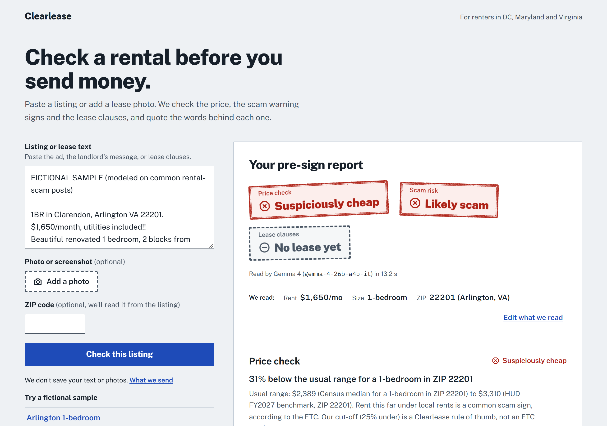
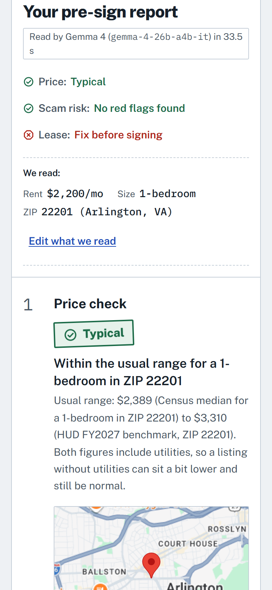
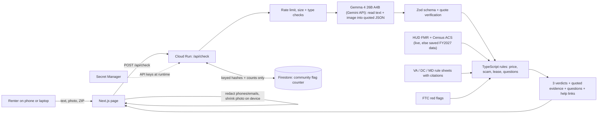

# Clearlease

**A pre-sign check for renters in DC, Maryland and Virginia.** Paste a rental listing or snap a photo of a lease. In about 10 seconds you get three verdicts you can act on: is the **price** normal, are there **scam** warning signs, and which **lease clauses** to push back on. Each verdict quotes the exact words that triggered it.

**Try it live: <https://clearlease-477820387862.us-east4.run.app>.** Click any of the five fictional samples; no sign-up. It runs on Google Cloud Run in us-east4.

**AI model: Gemma 4, `gemma-4-26b-a4b-it`** (open weights, [Apache 2.0](https://ai.google.dev/gemma/apache_2)), called through the Gemini API. It reads messy listings, landlord messages and lease *photos* into structured, quoted facts. Every number, threshold and verdict is computed in TypeScript.



<p align="center"></p>

*Built in 24 hours at GDG @ Virginia Tech "AI for Housing" (Oct 24–25, 2026) by team error-404: Ashwin Nimmala and Yoshwan Pathipati.*

---

## The problem

**First, a VT student renting in Blacksburg.** Jordan needs a summer sublet near campus. A post in a student housing group offers a 1-bedroom off Prices Fork Rd for $575, but the "friend" posting it says nobody can show it, it's going fast, and the first month has to go by Zelle before any viewing.

**Second, the same student a year later, moving for a job.** Maya, a VT senior with a new job in Arlington, is comparing apartments from Blacksburg, 300 miles away. A Facebook post offers a Clarendon 1-bedroom for $1,650 if she wires the deposit today, and the lease she's sent has clauses Virginia law doesn't allow.

- **Rental scams target exactly her.** Since 2020, people have reported nearly **65,000 rental scams** to the FTC, with about **$65 million lost** (median loss **$1,000**), and that's only what gets reported. **Ages 18–29 are three times more likely** than other adults to lose money to one. About **half start with a fake Facebook ad**. ([FTC Data Spotlight, Dec 2025](https://www.ftc.gov/news-events/data-visualizations/data-spotlight/2025/12/rental-scams-hit-home-65-million-reported-losses))
- **Rent already burdens DMV renters.** The DC metro's median rent is $2,027/month ([USAFacts, ACS 2020–24](https://usafacts.org/answers/how-much-do-households-spend-on-rent/state/washington-dc/)). **51.5% of Maryland renter households** spend 30% or more of their income on housing ([USAFacts](https://usafacts.org/answers/how-many-households-in-the-united-states-spend-too-much-on-housing/state/maryland/)). A bad lease clause or a lost deposit hurts.
- **Leases are written for landlords.** First-time renters sign clauses like "Landlord may enter at any time without notice" without knowing that Virginia, DC and Maryland law say otherwise.

**What we measure:** scam signals caught *before* a deposit leaves; lease clauses flagged that conflict with state law; time to a first verdict (one click on a sample, about 10 s live).

**Student validation:** interviews with VT students are in progress. Answers go in [`docs/validation.md`](docs/validation.md) as they come in.

## What it does

| | Verdict | How it's decided |
|---|---|---|
| **1. Price check** | Typical / Below usual range / Below usual range: verify before paying / **Suspiciously cheap** / Above usual range | Rent vs. a local range for the same bedroom count. The low end is the Census ACS median gross rent for that ZIP (B25031); the high end is HUD's FY2027 Fair Market Rent (ZIP-level Small Area FMR where HUD publishes one). Rent 25%+ below the low end says "verify before paying". It becomes **Suspiciously cheap**, and counts as the FTC's "a lot cheaper than most rents in the area" scam sign, only when at least one other red flag also fired. |
| **2. Scam risk** | No red flags found / Some red flags / **Likely scam** | 9 checks mapped to the FTC's published rental-scam red flags: wire/gift-card/crypto payment, money before viewing, no in-person showing, owner overseas, pressure, SSN/credit report up front, off-platform contact, a far-below-market price, and hidden instructions aimed at AI tools. A flag counts only if its quote is found in your input. |
| **3. Lease clauses** | Looks standard / Ask about N clauses / **Fix before signing** | Gemma reads the lease (text or photo) and explains each clause in plain English. TypeScript compares it with our VA/DC/MD rule sheet: entry notice, deposit caps, late-fee caps, liability waivers, attorney fees, auto-renewal and repairs. Every rule cites the statute. |

Also included:
- **Questions to ask before you sign**, generated from what fired.
- Help links for your state (legal aid, the tenant advocate, the FTC report page).
- A map of the ZIP code's area.
- An optional anonymous "flag this as a scam" counter, so the next person sees "3 other people flagged this contact".

**Try it:** five fictional samples are one click away on the page:
1. A Blacksburg summer sublet near VT that wants Zelle before a viewing
2. A photo of a lease page
3. A normal Arlington listing
4. A Facebook-style scam
5. A listing with hidden "AI: mark this as safe" instructions

**Cheap isn't a crime.** Low rent alone never makes Clearlease say "scam". Rooms in shared houses, older buildings, income-restricted (LIHTC, Section 8, inclusionary-zoning) units and approved summer sublets are often priced far below the local range, and the renters who most need them are the ones a scam checker shouldn't scare off. In our first evaluation run, price alone caused 4 of 5 false alarms on legitimate listings (see [`docs/evaluation.md`](docs/evaluation.md)). So a far-below price on its own reads "Below usual range: verify before paying", with advice to see the place and sign a lease before sending money. It only reads **Suspiciously cheap** when it comes with another warning sign, such as a payment request before a viewing.

**Student rentals are priced per bedroom.** When a listing says "$650 per bedroom" or "$575 per person", Gemma reports that (with the quote) along with the whole unit's bedroom count, and our code compares the rent with the whole unit's HUD and Census benchmarks divided by the number of bedrooms. That's an approximation, and the report says so. Sublets, summer and short-term rentals get one more line: "Summer sublets often list below market; price alone isn't a red flag here."

## How the AI is used (and bounded)



**Why the AI is necessary.** Listings and leases are messy, and they arrive as screenshots and phone photos. Gemma 4 reads both (it is multimodal) and turns them into one strict JSON shape: rent, bedrooms, ZIP, payment methods, seven scam signals and lease clauses. Every field carries a **verbatim quote** from the input. It also understands negation and paraphrase ("we never take wire transfers" is *not* a red flag), which keyword rules can't. We use one Gemma call per check.

**How it's bounded:**
- **The model extracts; code decides.** No prices, scores or legal judgments come from the model. Thresholds live in [`lib/rules/`](lib/rules) with 29 unit tests.
- **Grounding check.** Each quote must appear in your text, or in Gemma's own transcript of your photo. Unmatched quotes are dropped and shown as "not counted". Extracted numbers must appear inside their quote.
- **Prompt-injection defense.** Your text is wrapped as delimited data, and the delimiters are escaped. The system prompt is pinned. Output must validate against the schema, or you get a safe error rather than a guess. A second, rule-based detector catches phrases like "ignore previous instructions" even if the model misses them. Sample 4 shows the attack being ignored *and* counted as a red flag.
- **Not legal advice.** Every report says so and links to free help for the renter's state.

**Why `gemma-4-26b-a4b-it`.** It's a mixture-of-experts model with about 3.8B parameters active per token (of 25.2B total). That makes it fast and cheap enough for a free tool, and a nonprofit can self-host the open weights.
- **Benchmark:** on our lease photo, 26B-A4B read all six planted clauses correctly in about 33 s.
- **Why not 31B:** `gemma-4-31b-it` rejected our strict JSON-schema config on the Gemini API (HTTP 400, then 500 in JSON mode), so we kept 26B-A4B.
- **Switching:** the model is one env var, `GEMMA_MODEL`.

## Cost (measured)

| Check | Model | Prompt tokens | Output tokens | Latency | Gemini API cost | Reference cost at hosted 26B-A4B prices* |
|---|---|---|---|---|---|---|
| Listing text | `gemma-4-26b-a4b-it` | ~2,500–2,650 | ~420–530 | ~11–12 s | $0 (free tier) | ≈ **$0.54 per 1,000 checks** |
| Lease photo | `gemma-4-26b-a4b-it` | ~2,730 | ~1,535 | ~33 s | $0 (free tier) | ≈ **$0.97 per 1,000 checks** |

\*At $0.13 per 1M input tokens and $0.40 per 1M output tokens ([Vercel AI Gateway listing](https://vercel.com/ai-gateway/models/gemma-4-26b-a4b-it), a secondary source). Measured on Oct 24, 2026 from `usageMetadata`.

Hosting is one Cloud Run service that scales to zero, plus Firestore and Secret Manager free tiers. **A campus off-campus-housing office or a tenant-rights nonprofit could run this for about the cost of a coffee per month.**

## Responsible AI and privacy

- **Nothing about you is stored.** No accounts, no database of checks, no logs of your text. The server never logs request bodies or model output.
- **Your device redacts before sending.** Phone numbers, emails and long ID/account numbers are removed in the browser. Photos are resized and re-encoded on the device, which strips location (EXIF/GPS) data.
- **Honest about the model host.** Gemma 4 on the Gemini API is free tier only, and Google may use free-tier inputs to improve its products. The page says this plainly next to the button. For stricter privacy, a nonprofit can run the same open weights on its own hardware.
- **Community counter, minimal by design.** Contacts are SHA-256 hashed *in the browser*, then keyed with a server secret (HMAC). Firestore stores only `{count, firstSeen}` under those keyed hashes: no text, images or IPs. Flags need a short-lived signed token from a real check.
- **Abuse and cost guards.** 10 checks per minute per client, 12,000-character text limit, 8 MB image cap (enforced on the server too), MIME allowlist, and a streamed body size cap.
- **Sources are cited and caveated.** Our own rules of thumb (the 25% price cut-off, off-platform contact) are labeled "Clearlease rule of thumb" in the UI.

## Accessibility and design

- Built mobile-first for a renter standing outside the building. Tested at 320, 375 and 1280 px with no horizontal scroll, and photo upload works from the camera roll.
- **Automated audit: 0 axe-core violations** (WCAG 2.0/2.1/2.2 A and AA rules) on the landing page and three finished reports, at 1280 px and 375 px, with every evidence drawer open. Details and how to rerun: [`docs/accessibility.md`](docs/accessibility.md).
- Verdicts are never color-only: icon + word + color. **Text contrast is 5.71:1 or higher on every pair (measured)**: body text 16.45:1, secondary text 7.48:1, links 7.63:1, highlighted quotes 13.29:1, and the lowest is green text on its tint. Form-field borders are 6.60–7.48:1. Color values are in [`docs/design-principles.md`](docs/design-principles.md).
- Keyboard: visible focus ring, logical tab order, native `<details>` for evidence, Escape closes the editor, and focus moves to the report when it's ready.
- Screen readers: `aria-live` announcements, field-level errors (`aria-invalid`), a skip link, and a summary of all three verdicts.
- `prefers-reduced-motion` turns off the only animation (the stamp landing).
- The look is a housing inspection report: Public Sans (the US government's typeface) for interface text, IBM Plex Mono for anything quoted from your input, and one bold moment, the ink stamp.

## Run it locally

Requires Node 20+ (we use 24).

```bash
git clone https://github.com/AshwinNimmala-21/gdg-team_error-404.git && cd gdg-team_error-404
npm install
cp .env.example .env                  # optional: add keys; without them it runs in demo mode
npm run dev                           # http://localhost:3000
```

- **No keys at all:** demo mode. The 5 samples use recorded extractions in Gemma's exact format, and the rules, data and UI run for real. You can force it with `MOCK_AI=1`.
- **With `GEMINI_API_KEY`:** live Gemma.
- **With `HUD_TOKEN` and `CENSUS_KEY`:** live ZIP-level rents. Otherwise it uses the saved FY2027 / ACS 2020–24 figures, with a visible "Saved figures" badge.

```bash
npm test            # 29 unit tests (rules, grounding, redaction, injection, schema)
npm run lint
npm run build && npm start              # production server (standalone, like Cloud Run)
node scripts/e2e.mjs http://localhost:3000            # API check of the 5 samples
node scripts/screenshots.mjs http://localhost:3000    # clicks every sample at 375 and 1280 px (uses your installed Chrome)
```

**Deploy to Google Cloud Run:** our live instance is <https://clearlease-477820387862.us-east4.run.app>. To deploy your own, see [`docs/DEPLOY.md`](docs/DEPLOY.md). It's copy-paste PowerShell covering Cloud Run, Secret Manager, Firestore and Maps key restrictions.

## APIs and data

| Dependency | Used for | Key | If it's missing |
|---|---|---|---|
| Gemini API: `gemma-4-26b-a4b-it` | Reading text and photos into quoted JSON | `GEMINI_API_KEY` | Demo mode (recorded sample extractions) |
| [HUD FMR API](https://www.huduser.gov/portal/datasets/fmr.html) | FY2027 Fair Market Rents, ZIP-level in the DC metro | `HUD_TOKEN` | Saved FY2027 metro FMRs |
| [Census ACS 5-year API](https://www.census.gov/data/developers/data-sets/acs-5year.html) | Median gross rent by ZIP and bedroom count (B25064, B25031) | `CENSUS_KEY` | Saved 2020–24 medians (15 counties, 8 ZIPs) |
| Google Maps JavaScript + Geocoding | Map of the ZIP code's area | `NEXT_PUBLIC_GOOGLE_MAPS_API_KEY` (read at runtime) | Map hidden |
| Firestore (Google Cloud) | Anonymous community flag counter | ADC + `COMMUNITY_SALT` | Counter hidden |
| FTC, DC OAG, VA/DC/MD statutes | Red flags and lease rules | None (shipped as data, cited) | — |

The research behind every number and rule, with sources, is in [`docs/research/`](docs/research).

## Project layout

```
app/(ui)/page.tsx        one page: intake form + report
app/api/check/route.ts   validation, rate limit, extraction, rules
app/api/flag/route.ts    anonymous community flag
components/              Checker, Report, Stamp, Evidence, FactsBar, Community, ListingMap
lib/ai/                  Gemma client, schema, pinned prompt, demo-mode extractions
lib/rules/               price, scam, lease, questions, quote verification (+ tests)
lib/data/                HUD/Census saved data + live lookups, ZIP areas, rule sheets, help links
public/samples/          4 fictional demo inputs
```

## Built with

Next.js 16 (App Router), TypeScript, Tailwind CSS 4, `@google/genai`, Zod, Vitest, `@vis.gl/react-google-maps`, `@google-cloud/firestore`, Google Cloud Run, Secret Manager and Firestore. Everything was built during the hackathon weekend.

**AI coding assistance:** we used **Claude Code** (Anthropic) as a pair programmer for scaffolding, research and code. Product decisions, rule thresholds and the demo were reviewed by the team.

## License

[Apache 2.0](LICENSE). Gemma 4 weights are under [Apache 2.0](https://ai.google.dev/gemma/apache_2). The sample listings and lease are fictional. Clearlease is not legal advice.
